# Hi, I'm Ismail Opu 👋

**Full-stack developer · CS @ BRAC University · Physics instructor**

I build AI-powered SaaS products and multiplayer 3D browser games, from the database schema to the deployed UI.

  

---

### 🧑‍💻 What I'm doing now

- 🎮 Building **Haunted Lobby**, a multiplayer 3D horror game that runs in the browser
- 🤖 Shipping AI products for online businesses in Bangladesh: **ShopMind AI** and **Lumina Insights**
- 🧪 Teaching physics at **Hulkenstein**, recording 36+ classes a season for the private university admission batch
- 🎓 Studying Computer Science at **BRAC University** (graduating 2027)
- 💼 Open to freelance work, internships and full-time roles (remote friendly)

---

### 🚀 Featured projects

<table>
<tr>
<td width="42%"></td>
<td>

#### 👻 Haunted Lobby
3D co-op horror and social deduction game for 4–8 friends. The ghost hears your real microphone, so you have to whisper to survive.

`TypeScript` `Three.js` `Colyseus` `LiveKit` `Rapier`

[▶ Play it](https://haunted-lobby.vercel.app) · [Code](https://github.com/IsmailOpu1/haunted-lobby)

</td>
</tr>
<tr>
<td width="42%"></td>
<td>

#### 🛍️ ShopMind AI
AI shopping assistant that online stores add with one script tag. It searches the store's catalog with pgvector plus keywords and replies in English, Bangla or Banglish.

`React` `TypeScript` `Supabase` `pgvector` `Gemini`

[▶ Live demo](https://shopmind-ai-tau.vercel.app) · [Code](https://github.com/IsmailOpu1/shopmind-ai-hub)

</td>
</tr>
<tr>
<td width="42%"></td>
<td>

#### 📊 Lumina Insights
Multi-tenant SaaS for small businesses in Bangladesh: orders, stock, real profit, marketing content and an AI business advisor.

`React` `TypeScript` `Supabase` `PostgreSQL` `Gemini`

[▶ Live demo](https://lumina-insights-ashen.vercel.app) · [Code](https://github.com/IsmailOpu1/Lumina-Insights)

</td>
</tr>
</table>

---

### 🛠 Tech stack

  

---

**Have an idea or a role in mind?** [Email me](https://mail.google.com/mail/?view=cm&fs=1&to=ismailopu0.0@gmail.com) or see more on my [portfolio](https://ismailopu.is-a.dev).

